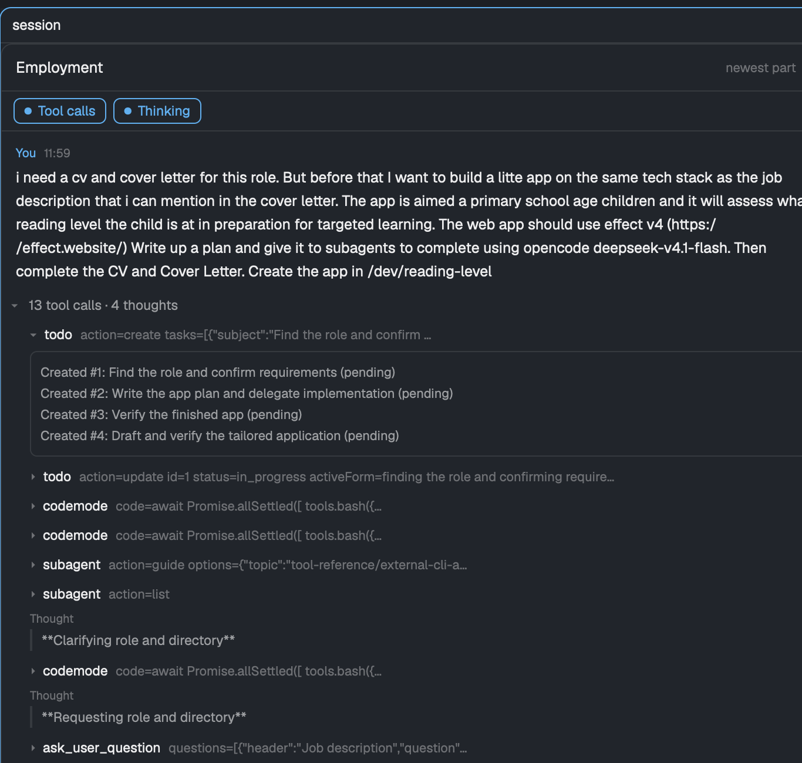

# Session

A panel that reads the pi session running in the tab beside it: the discussion as written, with
pi's tool calls and thinking folded to one line each, and a filter bar that can hide them so only
the discussion is left. It is read-only: it never sends anything to pi and never changes a session
file.

## What you see

A card the size of the pane it is split into: `theme().background` behind, a 1 px `border` edge,
a 10 px radius, 13 px text in `foreground`.

- **Header, 40 px.** Left: the folder whose session is on screen, semibold, cut with an ellipsis.
  Right: 11 px in `dim`, saying one of three things — the session's start time (`11:52`) while the
  whole file is shown, `newest part` when only the end of a long file is, or `other folder` when
  the session belongs to a different folder than the terminal beside it. A 9 px `▸` follows, and
  the whole label is a button that opens the session list.
- **Filter row, 34 px,** above the transcript. Two chips, 22 px high, 8 px padding, 6 px radius,
  11.5 px text, each prefixed with `●` or `○` at 8 px. On: `accent` text and border. Off: `border`
  and `dim`. Right of them, when both are off, the words `discussion only` in 11 px `dim`.
- **The session list,** when opened: up to 12 rows, 24 px each, a `dim` 11 px start time in a 34 px
  column, then the first 8 characters of the session's id at 11.5 px — `accent` and marked `shown`
  for the one on screen.
- **The transcript,** scrolling. A person's message is a row with `You` in `accent`; pi's words are
  a row with `Pi` in `muted`. Both labels are 10.5 px semibold, followed by the record's clock time
  at 10 px `dim`, then the text at 12.5 px in `foreground`, drawn one element per line so code and
  blank lines keep their shape. Rows are padded 12 px across and 6 px up and down. Text past 8,000
  characters ends with `… N more characters`.
- **Folded rows,** standing where pi worked between two of its words: 24 px high, 6 px radius, a
  9 px `▸` or `▾` in `dim`, and the summary at 11.5 px in `muted` — `13 tool calls · 4 thoughts`,
  `Thought`, `2 thoughts`, with `· 1 failed` added when a call in it failed.
- **An opened folded row:** each step on its own line, indented 24 px. A thought is labelled
  `Thought` at 10 px `dim` over its words at 11.5 px `muted`, against a 2 px `border` rule. A tool
  call is its name at 11.5 px medium in `foreground` (`blocked` when it failed) and its arguments
  at 11 px `dim`, cut to one line; while no result has arrived yet it says `running` at 10 px.
  Clicking the call opens its result in a `surface` box with a 1 px `border`, 11 px `muted`
  (or `blocked` when it failed), cut at 3,000 characters.

Every colour is a `theme()` name, so the panel follows light and dark themes.

## How it behaves

- **Which session.** It reads the folder of the terminal in the panel's own tab — panes in the tab
  it is split into, and when the panel itself holds the keyboard, the tab's first terminal with a
  folder. In that folder it shows pi's newest session, then keeps up with it. When the folder has
  no session yet, it shows the newest session anywhere and says `other folder`. The header button
  lists the folder's newest 12 sessions; choosing one keeps it until the folder changes.
- **The filter bar.** Both chips start on, so folded lines are visible but closed. Clicking a chip
  takes its rows out of the transcript at once: tool calls off leaves thinking, thinking off leaves
  tool calls, and both off leaves only what was said, with `discussion only` shown at the right.
  The choice is remembered per person and per panel in the mod's `localStorage` under
  `session.filters.v2`, so it survives a restart.
- **Folding.** Every folded row is closed when the panel opens, and each one opens on its own click.
  Inside an opened row every tool call keeps its own result closed until clicked. Nothing opens by
  itself, so opening a session never dumps a wall of tool output at you.
- **Updating.** A `watchFolder` on `~/.pi/agent/sessions` wakes the panel when pi writes, and a look
  every 8 seconds catches anything the watch missed. Only what the file gained is parsed. Rows are
  drawn 200 at a time; older ones come in on `Show N earlier rows` at the top.
- **Nothing else changes.** It runs no Herdr commands, opens no overlays and writes no files. The
  only state it keeps is the two chips.

## Built from

Three files in `mods/session/`:

- `main.js` — the view. `init` follows the folder, `reload` finds the folder's sessions with
  `ls -1t`, `load` reads the file, `loadTail` reads the end of a long one, `render` draws the four
  regions above.
- `parse.js` — no Herdr imports, so it can be run on a real session file with node: `encodeDir`,
  `timeFromName`, `textOf`, `argSummary`, `firstWords`, `buildRows`, `summarize`, `visibleSteps`.
  `buildRows` turns records into `user` / `say` / `work` rows, attaching each tool result to its call
  by `toolCallId`.
- `mod.json` — `{"place": "right", "size": 380}`, so Herdr docks it on the right the first time it
  sees the folder.

Data: pi's session files, append-only JSONL at `~/.pi/agent/sessions/<encoded cwd>/<start>_<id>.jsonl`,
where the folder is `--` + the cwd with its leading slash dropped and every `/` or `:` replaced by
`-`, then `--`. The panel reads the `session` record (folder, id, start) and `message` records whose
role is `user`, `assistant` or `toolResult`; inside an assistant message it uses `text`, `thinking`
and `toolCall` blocks, and each `toolResult`'s `toolCallId`, `content` and `isError`. Other record
types (`model_change`, `custom`, …) are ignored.

From `herdr`: `focused`, `panes`, `spaces`, `theme`, `home`, `checking`, `window`, `readTextFile`,
`watchFolder`, and `exec` for four small shells — `ls -1t <dir>`, `wc -c < "$1"`,
`head -c 4096 "$1"`, `tail -c 4000000 "$1"` (and `ls -1t …/*/*.jsonl` for the any-folder
fallback). From `gpui-kit` and `gpui-base`: `View`, `div`, `v_flex`, `h_flex`. No Herdr commands
(`run`), no network.

## Watch out

- `readTextFile` stops at 1 MiB, and pi session files pass that quickly (one is 6 MB here). Past it
  the panel falls to `loadTail`, which reads the newest 4,000,000 bytes with `tail` and the first
  4,096 with `head`, and says `newest part` in the header. Anything older than that window is not
  reachable — there is no "read further back" control.
- After the first read only the bytes that arrived are parsed, which needs the window to have slid by
  exactly as many characters as the file grew. That holds for plain ASCII and is checked with a
  `startsWith` before anything is skipped; when it does not hold (any multi-byte character in the
  window) the whole window is parsed again. Do not "optimise" that check away.
- `sh`, `wc`, `head`, `tail` and `ls` are taken as given, so long sessions need macOS or Linux. Under
  1 MiB the plain read path works anywhere.
- Rewinds and forks are not resolved: the panel draws messages in file order, so a forked session can
  show both branches one after the other. `buildRows` also drops a `toolResult` whose call fell out
  of the 3,000 records kept, so its call reads `running` forever.
- The panel does not scroll itself to the newest message. Rows are appended below; the reader scrolls.
- The header shows the session's start time, not the time of the newest message, and only while the
  whole file is shown.
- It is a pi-specific panel: it reads pi's JSONL, not another agent's transcript.
- Two panels in different tabs show different sessions: each copy follows its own tab's folder.

## Done when

- `herdr-app check ~/.config/herdr-app/mods/session` passes.
- Split right with the mod beside a pi terminal (`herdr-app do pane.split --direction right --mod
  session`): the header names that terminal's folder, `You` and `Pi` rows appear, and between them
  folded lines reading `N tool calls`, `N thoughts` or `Thought`.
- Clicking a folded line lists its steps; clicking a tool call shows its result, and a call with no
  result says `running`.
- Turning both chips off leaves only the discussion rows and the words `discussion only`; the chips
  come back in that state after Herdr restarts.
- Clicking the header's label lists that folder's sessions, `shown` marks the current one, and
  choosing another replaces the transcript.
- Writing to the session in the terminal beside the panel adds rows within a couple of seconds.
